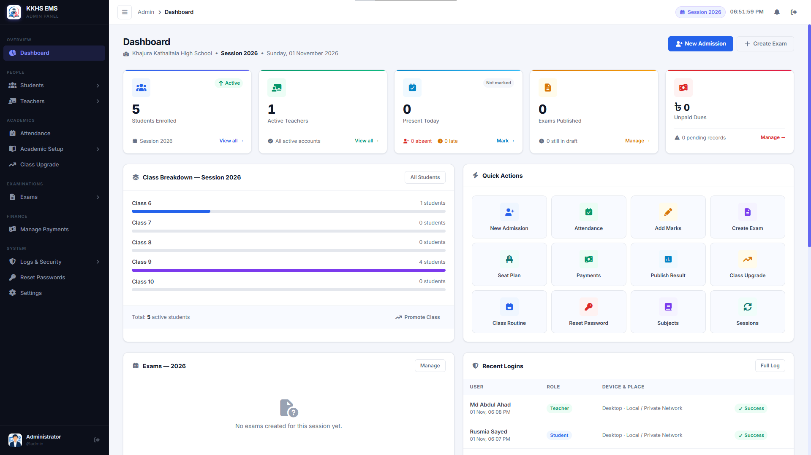
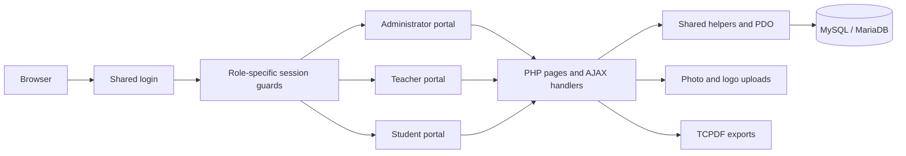

<div align="center">

# School EMS

### Education Management System

A school management application connecting administration, teachers, and students through dedicated portals.

**PHP · MySQL / MariaDB · Vanilla JavaScript · TCPDF**

[Features](#features) · [Screenshots](docs/screenshots/README.md) · [Installation](#installation) · [Project structure](#project-structure)

</div>

---

## Overview

School EMS brings student admission, academic planning, attendance, examinations, results, and fee records into one application. Built for Khajura Kathaltala High School, it includes workflows for Classes 6–10, Science/Arts/Commerce groups, academic sessions, subject choices, scholarships, and student promotion.

Administrators manage school operations, teachers work with their assigned classes and subjects, and students access their own academic and financial records. The application uses server-rendered PHP pages with AJAX interactions and separate responsive interfaces for each role.

School branding can be managed through the administrator settings page. Database access and deployment URLs are configured in PHP.

**Public distribution:** Application source, approved assets, and documentation are intended for GitHub. Database exports, backups, real records, and the PHPMailer, TCPDF, and Matomo Device Detector libraries must be excluded from the upload. Local copies may still exist in a development checkout. Install dependencies separately using the instructions below. To request the corresponding database file, contact **[habibur@eidhl.com](mailto:habibur@eidhl.com)**.

## Preview

<table>
  <tr><th>Application preview</th></tr>
  <tr><td align="center"><br><br><em>Screenshot space reserved</em><br><br><br></td></tr>
</table>

<!-- Once uploaded, replace the table above with:

-->

Visit the **[screenshot gallery](docs/screenshots/README.md)** for dedicated spaces for the login page, administrator tools, teacher portal, and student portal. Image files belong in `docs/screenshots/`.

## Contents

- [Overview](#overview)
- [Preview](#preview)
- [Features](#features)
- [User roles](#user-roles)
- [Typical school workflow](#typical-school-workflow)
- [Technology](#technology)
- [System requirements](#system-requirements)
- [Installation](#installation)
- [Configuration](#configuration)
- [Project structure](#project-structure)
- [Architecture and database](#architecture-and-database)
- [Workflow limits](#workflow-limits)
- [Page and endpoint reference](#page-and-endpoint-reference)
- [PDF and printing](#pdf-and-printing)
- [Troubleshooting](#troubleshooting)
- [Development and verification](#development-and-verification)
- [Security considerations](#security-considerations)
- [Preparing a public repository](#preparing-a-public-repository)
- [Contributing](#contributing)
- [Project details](#project-details)
- [License and copyright](#license-and-copyright)

## Features

### Administrator portal

| Area | Capabilities |
| --- | --- |
| Dashboard | School overview, summary cards, charts, and navigation to operational tools. |
| Admission and students | Admit students, manage profiles and photos, maintain enrollment details, filter records, manage account status, and export student information. |
| Teachers | Manage teacher profiles, contact details, photos, account status, and passwords. |
| Academic sessions | Create and edit sessions and select the current academic session. |
| Subjects | Manage class/group subjects and subject configuration. |
| Teacher assignments | Assign teaching responsibilities by academic context. |
| Class routine | Manage timetable periods and slots with teacher conflict checks. |
| Attendance | Record attendance, inspect date status, and review reports and summaries. |
| Examinations | Create exams, configure exam subjects and schedules, and manage exam states. |
| Marks | Enter and update marks, calculate grades, review subject progress, and maintain result summaries. |
| Results | Preview results, publish or unpublish them, manage mark locks through the Results handler, and export result sheets. Administrator overrides and calculation differences are described under Workflow limits. |
| Seat planning | Maintain shared exam rooms, select rooms for exams, manage participation, check overlapping schedules, assign seats automatically, and generate room sheets. |
| Payments | Create and edit dues, account for scholarship percentages, record payments, and inspect student ledgers. |
| Promotion | Preview and save student promotions with enrollment and subject-choice handling. |
| Account administration | Find users, generate passwords, and reset account passwords. |
| Logs | Review login history and activity records, including administrative notifications. |
| Settings | Update school details and logo, change the administrator password, inspect system information, and manage maintenance mode. |

### Teacher portal

- Dashboard with teaching information and pending work.
- Today's classes and personal teaching routine.
- Student rosters for assigned classes.
- Attendance entry for authorized classes.
- Marks entry for assigned subjects.
- Profile, contact information, photo upload, and password changes.

### Student portal

- Personal dashboard and profile.
- Class routine and monthly attendance history.
- Published examination results.
- Exam seat assignments.
- Admit-card access and browser printing, subject to eligibility checks.
- Payment ledger with dues and recorded payments.
- Password changes.

Payment features track dues and receipts recorded by staff; no online payment gateway is included in the current application.

## User roles

| Role | Main responsibility | Entry page |
| --- | --- | --- |
| Administrator | School-wide records, configuration, and academic operations | `admin/dashboard.php` |
| Teacher | Assigned teaching, attendance, and marks workflows | `teacher/dashboard.php` |
| Student | Personal academic records and payment information | `student/dashboard.php` |

All roles sign in through `index.php`. Authentication accepts a username or system UID; students can also use their student ID. Protected pages use role-specific session guards, and teacher/student handlers apply assignment or ownership checks where relevant.

Teacher class access is derived from `class_routine` assignments for the current session; subject access also checks the teacher, session, class, and subject. Student handlers resolve enrollments against the signed-in student's UID. These roles are fixed in the source; a configurable permission editor is not included.

## Typical school workflow

1. Configure the school profile and current academic session.
2. Set up subjects, add teachers, and assign teaching responsibilities.
3. Admit students and verify class, group, roll, and subject choices.
4. Build class routines and record attendance.
5. Create exams and configure subject schedules and marks.
6. Select exam rooms, review participation and conflicts, and generate seat allocations.
7. Enter marks, review summaries, and publish results for students. Teachers currently enter marks only while the exam is in `draft`; review [Workflow limits](#workflow-limits) before changing its state.
8. Maintain fee dues and payments throughout the session.
9. Review promotion previews and enroll students for the next session.

## Technology

| Layer | Implementation |
| --- | --- |
| Backend | Plain PHP with procedural page scripts and shared helpers |
| Database | MySQL-compatible database using PDO, prepared statements, and InnoDB tables |
| Frontend | HTML, CSS, vanilla JavaScript, Fetch API, and FormData |
| Charts | Locally bundled Chart.js asset |
| Documents | Separately installed TCPDF with shared PDF helpers |
| Device information | Composer dependency `matomo/device-detector` |
| Icons and fonts | Font Awesome and Google Fonts loaded from external services |
| Web server | Apache configuration with optional extensionless PHP routes |

There is no Node.js build step or frontend package installation required for the current PHP application.

## System requirements

| Requirement | Notes |
| --- | --- |
| PHP | PHP 8 syntax is required, including `mixed` return types. The precise supported runtime range has not been tested; check the requirements of the dependency releases you install. |
| Database | MySQL/MariaDB with InnoDB and `utf8mb4`; request a matching database from the maintainer. Cross-version schema compatibility has not been certified. |
| PHP extensions | PDO MySQL for database access and Fileinfo for MIME checks. Check GD/mbstring requirements for the chosen PDF/image dependencies. |
| Web server | Apache with `mod_rewrite` and appropriate `AllowOverride` settings for the supplied `.htaccess`. |
| Dependency setup | Composer for Device Detector, or a locally prepared Composer vendor directory transferred to the application host. |
| Browser | JavaScript enabled, Fetch API support, and printing support for admit cards. |
| Filesystem | Writable upload folders and `includes/maintenance-status.php` for their respective features. |
| Network | CDN access for fonts/icons; optional public-IP lookup uses PHP URL streams (`allow_url_fopen`). |

## Installation

### 1. Prepare the environment

Use an Apache/PHP/MySQL-compatible environment such as XAMPP and check the requirements above. Installation and runtime compatibility must be verified on your own environment.

Enable PDO MySQL and Fileinfo. Enable GD and mbstring for image/document functionality where needed. Composer is needed if restoring PHP dependencies from the manifest. Allow outbound access for externally hosted fonts, icons, and optional IP lookup.

### 2. Place the application in the web root

Download the repository or clone your own repository URL, then place its contents in the Apache document root. The current configuration assumes the application is served at the site root, for example:

```text
C:\xampp\htdocs\index.php
C:\xampp\htdocs\admin\
C:\xampp\htdocs\includes\
```

Start Apache and MySQL in the XAMPP Control Panel. A dedicated virtual host is also suitable. For a subdirectory installation, update URLs and rewrite settings as described under [Configuration](#configuration).

### 3. Request and import the database

**Database files (`.sql`), including schema exports and migrations, are not provided on GitHub.** Email **[habibur@eidhl.com](mailto:habibur@eidhl.com)** to request the database file matching this version of School EMS. The database is required to run the application.

After receiving the file:

1. Follow any accompanying database setup instructions.
2. Open phpMyAdmin and create an empty database named `ems` with `utf8mb4` character encoding, unless the supplied instructions specify otherwise.
3. Select that database and import the supplied SQL file. If it contains its own `CREATE DATABASE` or `USE` statements, confirm the database name they select.
4. Confirm that tables, indexes, and foreign keys imported successfully.
5. Set `DB_NAME` in `includes/db.php` to the imported database's name.

Back up an existing installation before importing data or applying schema changes. Keep the supplied SQL file outside the public web root and out of the public repository.

### 4. Configure the connection

Edit `includes/db.php` for your local database:

```php
define('DB_HOST', 'localhost');
define('DB_NAME', 'ems');
define('DB_USER', 'root');
define('DB_PASS', '');
define('DB_CHARSET', 'utf8mb4');
define('BASE_URL', 'http://localhost');
```

These are local XAMPP defaults. Use credentials appropriate to your installation. The application reads PHP constants directly; it does not currently load a `.env` file.

### 5. Install third-party extensions

PHPMailer, TCPDF, and Matomo Device Detector are distributed separately from this repository. Obtain them from their official projects and follow their respective license terms.

| Dependency | Functionality and absence behavior |
| --- | --- |
| TCPDF | Required by the four administrator PDF export scripts. Those exports cannot run without it; browser admit-card printing is separate. |
| Matomo Device Detector | Enriches browser, operating-system, and device details in login logs. Basic user-agent detection remains available if the library is missing. |
| PHPMailer | Optional integration instructions only. No active mail-sending code or SMTP configuration was found in the reviewed application. |

**Matomo Device Detector:** From the repository root, install the dependency declared in `extensions/composer.json`:

```sh
composer install --working-dir=extensions
```

This creates `extensions/vendor/autoload.php`, which `includes/functions.php` already loads for device detection. The manifest requests `matomo/device-detector` with constraint `^6.4`; no lockfile is currently included, so exact dependency versions are not pinned. If installing on a host without Composer, run the command locally and transfer the generated `extensions/vendor/` directory to that host, not to the public GitHub repository. See the [official Device Detector instructions](https://github.com/matomo-org/device-detector).

**TCPDF:** Obtain a compatible classic 6.x release from the [official TCPDF releases](https://github.com/tecnickcom/TCPDF/releases) and extract its contents into `extensions/TCPDF/`. Confirm that `extensions/TCPDF/tcpdf.php` exists directly at that path; retain its supporting directories and fonts. The local development copy identifies itself as 6.7.5; this identifies the implementation reviewed, not a recommendation to deploy that old release. Review upstream fixes and validate all exports with your selected version.

The [upstream TCPDF documentation](https://github.com/tecnickcom/TCPDF) now describes a version 7 compatibility layer and changed font/dependency behavior. Do not assume that downloading the default branch or substituting `tc-lib-pdf` will work with this application's direct includes and legacy fonts; a major-version upgrade needs separate integration testing.

For Bengali PDFs, `includes/pdf-helper.php` expects a registered font named `nikosh`. Install/register an appropriately licensed Bengali font with TCPDF and set `BN_FONT` to its registered name if different; a stock TCPDF download may not include this custom font.

**PHPMailer:** Download the package from the [official PHPMailer repository](https://github.com/PHPMailer/PHPMailer) and extract it into `extensions/PHPMailer/`, keeping its `src/` directory. In a mail helper under `includes/`, load these files:

```php
require_once __DIR__ . '/../extensions/PHPMailer/src/Exception.php';
require_once __DIR__ . '/../extensions/PHPMailer/src/PHPMailer.php';
require_once __DIR__ . '/../extensions/PHPMailer/src/SMTP.php';
```

Create a `\PHPMailer\PHPMailer\PHPMailer` instance and configure your SMTP host, port, encryption, credentials, and sender before sending mail. No PHPMailer calls or SMTP configuration are present in the reviewed application source, so these are integration instructions for mail functionality you add; copying the library alone does not enable email delivery.

### 6. Check writable locations

The web-server account needs write access to the applicable upload folders:

```text
uploads/student/photos/
uploads/teacher/photos/
uploads/school/
```

Maintenance settings also write to `includes/maintenance-status.php`. Grant access to the required locations according to the hosting environment.

### 7. Sign in and finish setup

Open `http://localhost/index.php` and choose the appropriate role. Use the account setup instructions supplied with the database, or an account you have configured yourself. Contact [habibur@eidhl.com](mailto:habibur@eidhl.com) if you need initial administrator setup details; no public demo credentials are provided here.

If restoring a database without a known administrator password, generate a new hash with PHP's `password_hash()` and update only the intended administrator's `system_users.password_hash` through a trusted database administration tool. Confirm that account's role and active status. After signing in, review school settings, the active session, and user accounts.

## Configuration

| Setting | Location | Notes |
| --- | --- | --- |
| Database and base URL | `includes/db.php` | Configure host, database, user, password, and public application URL. |
| Branding defaults and asset URLs | `includes/db.php` | Update localhost-based logo and favicon URLs when deploying. |
| School profile overrides | Admin → Settings / `app_settings` | Stored school details override application defaults through shared helpers. |
| Login throttling secret | `includes/functions.php` | Replace the `RL_SECRET` placeholder with a private random value. |
| PHP session cookies | `includes/db.php` | Secure-only session cookies are currently commented out; enable them for HTTPS deployments. |
| Rate-limit cookies | `includes/functions.php` | Currently use `secure => true`; local HTTP behavior needs separate attention. |
| Maintenance state | `includes/maintenance-status.php` | Managed from administrator settings; can be manually disabled with `active => false`. |
| Routing and error destinations | `.htaccess` | Includes root-based rewrites, localhost error destinations, and cPanel PHP handler directives. |
| Timezone | PHP configuration / `includes/db.php` | The explicit PHP and database timezone lines in `db.php` are commented out. Align time settings for the deployment. |

For subdirectory hosting, review `BASE_URL`, asset URLs, `.htaccess` `RewriteBase`, and any root-relative links. Adapt the cPanel-specific `AddHandler` directives to your Apache/PHP environment. Extensionless routes require `mod_rewrite` and permission for Apache to read `.htaccess` overrides.

## Project structure

```text
.
├── README.md                     # Repository overview and setup
├── .gitignore                    # Git exclusions; not a GitHub Web filter
├── docs/
│   ├── PUBLICATION_REVIEW.md      # Source findings and manual upload checklist
│   └── screenshots/              # GitHub gallery and future screenshots
├── index.php                     # Shared role-based login
├── logout.php
├── maintenance.php
├── .htaccess                     # Apache routing and response configuration
├── admin/
│   ├── dashboard.php
│   ├── *-ajax.php                # Administrative JSON handlers
│   ├── *-pdf.php                 # Document exports
│   ├── includes/                 # Shared administrator shell
│   └── assets/                   # CSS, scripts, and charts
├── teacher/                      # Teacher pages, handlers, and shared shell
├── student/                      # Student pages, handlers, and shared shell
├── student-build/                # Additional student interface assets/includes
├── includes/
│   ├── db.php                    # Connection and application constants
│   ├── functions.php             # Auth utilities, settings, CSRF, and logging
│   ├── admin-session.php
│   ├── teacher-session.php
│   ├── student-session.php
│   ├── pdf-helper.php
│   ├── maintenance-guard.php
│   └── maintenance-status.php
├── assets/                       # Shared images, datepicker, and timepicker
├── extensions/                   # Manifest; libraries installed separately
├── uploads/                      # User photos and school logo uploads
└── PROJECT_KNOWLEDGE.md           # Local internal notes; omit from public upload
```

The active student portal is `student/`. Alternate dashboard files and `student-build/` are also present; the standard entry pages above describe the primary portal routes. Some historical notes in `PROJECT_KNOWLEDGE.md` predate the current modules and configuration.

## Architecture and database



| Domain | Main tables |
| --- | --- |
| Accounts and profiles | `system_users`, `students`, `teachers` |
| Academic organization | `sessions`, `classes`, `groups`, `subjects`, `enrollments` |
| Teaching and attendance | `class_routine`, `attendance` |
| Exams and performance | `exams`, `exam_subjects`, `student_marks`, `exam_results_summary` |
| Shared room seat planning | `exam_rooms_global`, `exam_room_usage`, `seat_allocations_v2`, `seat_exclusions` |
| Earlier seat-plan structures | `exam_rooms`, `seat_allocations` |
| Fees | `payment_dues`, `payment_records` |
| Configuration and history | `app_settings`, `login_logs`, `activity_logs` |

`sys_uid` connects accounts with student or teacher profiles. Enrollments associate students with a session, class, and optional group and subject choices. Exam subjects connect schedules and mark configuration to an exam. Seat-plan room usage connects reusable rooms to exams, while allocations identify the student enrollment, exam subject, and seat.

The implementation includes password hashing/verification, prepared queries, CSRF helpers, role guards, output-escaping helpers, session ID renewal, and login/activity logging. Login throttling uses a signed browser cookie; it is not a centralized server-side rate limiter. Device detection uses the Composer package when available, and public-IP geolocation uses an external service. These describe implemented mechanisms, not an independent security audit.

### Workflow limits

- **Marks permissions:** `teacher/marks-ajax.php` restricts entry to draft exams and rejects locked records. `admin/marks-ajax.php` explicitly allows administrator edits after publication and clears the saved record's lock. Publication does not make records immutable for administrators.
- **Publication paths:** `admin/results-ajax.php` rebuilds summaries and locks marks on publication, and unlocks them on unpublication. The separate `publish_exam` action in `admin/exams-ajax.php` changes exam status without that rebuild/lock sequence. These actions are not equivalent.
- **GPA calculation:** The administrator marks handler applies fourth-subject bonus logic. The Results publication handler rebuilds GPA as an average of the recorded subject grade points and marks the result failed if any recorded subject fails. Publishing can therefore change a summary. Confirm the intended school policy before relying on final grades; no board-compliance claim is made here.
- **Admit cards:** Student access checks enrollment ownership, fee clearance, and exam participation exclusions. Seat data depends on the administrator's allocation setup.
- **Seat planning:** Rooms are shared across exams; allocation checks consider schedule overlap and capacity. The handler attempts to create missing support tables, but this does not install the complete application database.
- **Maintenance:** Active maintenance returns HTTP 503 to other visitors while an already signed-in administrator session bypasses it. Keep access to the maintenance state file for recovery if no administrator session remains.

## Page and endpoint reference

| Area | Main pages |
| --- | --- |
| Public | `index.php`, `logout.php`, `maintenance.php` |
| Admin: people | `admin/admission.php`, `admin/students.php`, `admin/teachers.php` |
| Admin: academics | `admin/sessions.php`, `admin/subjects.php`, `admin/assign-teacher.php`, `admin/routine.php` |
| Admin: exams | `admin/exams.php`, `admin/marks.php`, `admin/results.php`, `admin/seat-plan.php` |
| Admin: operations | `admin/attendance.php`, `admin/payments.php`, `admin/promote.php` |
| Admin: system | `admin/settings.php`, `admin/reset-password.php`, `admin/login-logs.php`, `admin/activity-log.php` |
| Teacher | `teacher/dashboard.php`, `teacher/today.php`, `teacher/routine.php`, `teacher/students.php`, `teacher/attendance.php`, `teacher/marks.php`, `teacher/profile.php` |
| Student | `student/dashboard.php`, `student/profile.php`, `student/routine.php`, `student/attendance.php`, `student/results.php`, `student/seat-plan.php`, `student/admit-card.php`, `student/payments.php` |

Most interactive pages use a matching `*-ajax.php` handler. These are internal browser-session endpoints, not a documented public REST API. Typical requests use POST with an `action` and `csrf_token`; JSON responses carry `ok`, response data or a message, and a refreshed CSRF token. Check the specific handler for its supported actions and response fields.

Exceptions matter when building clients: login returns `csrf_token`, while most handlers return `csrf`. `admin/attendance-summary-ajax.php` reads a `days` parameter through GET or POST without rotating CSRF. The administrator notification actions `notif_count` and `notif_fetch` bypass CSRF; fetching notifications also marks returned entries read. Session guards or maintenance checks can return redirects/HTML instead of JSON.

## PDF and printing

| Output | Implementation |
| --- | --- |
| Student lists | `admin/students-pdf.php` |
| Individual student profiles | `admin/student-profile-pdf.php` |
| Result sheets | `admin/results-pdf.php` |
| Exam seat plans | `admin/seat-plan-pdf.php` |
| Student admit cards | Browser printing from `student/admit-card.php` |

Shared PDF helpers include handling for mixed Bengali and English text. Install the required TCPDF font assets as described above and inspect generated documents when changing school branding or fonts.

## Troubleshooting

| Symptom | What to check |
| --- | --- |
| Database connection unavailable | Database service, credentials, PDO MySQL, and the database name in `includes/db.php`. |
| Missing database file, tables, or columns | Request the matching database and setup instructions from [habibur@eidhl.com](mailto:habibur@eidhl.com), then confirm the import completed. |
| Login fails after importing | Verify the selected role, username, active status, and password hash. Credentials from one snapshot may not apply to another. |
| Login throttling behaves differently locally | Inspect secure-cookie settings; rate-limit cookies are currently configured for HTTPS. |
| Assets or redirects point to localhost | Review `BASE_URL`, logo/favicon constants, stored logo values, and `.htaccess`. |
| Extensionless pages fail or Apache returns errors | Check rewrite support, `AllowOverride`, `RewriteBase`, and PHP handler directives. Try the explicit `.php` URL. |
| Photo/logo upload fails | Check directory permissions, PHP upload limits, and supported image type/size limits in the handler. |
| Maintenance changes cannot be saved | Check write access to `includes/maintenance-status.php`. |
| PDF export fails or text is missing | Verify `extensions/TCPDF/tcpdf.php`, registered fonts including `BN_FONT`, image paths, and the PHP error log. |
| A list is unexpectedly empty | Check the chosen session, class/group filters, assignments, enrollment status, and database errors in the server log. |

## Development and verification

Follow the existing page/handler pattern: load the appropriate role guard, validate inputs and ownership, verify CSRF for mutations, use parameterized queries, and log meaningful changes. Use transactions for operations that must update multiple records together. Keep shared portal UI in its role-specific includes and assets.

No application-level automated test suite or CI workflow is included in this workspace. The following are useful manual checks after setup or a change:

- Sign in and out as each role; confirm protected pages reject the wrong role.
- Create a fictional student and teacher, then check assignments and enrollment filters.
- Save a routine slot and attendance record and verify the relevant portal views.
- Create a sample exam, allocate seats, enter marks, publish results, and inspect student access.
- Record a due and payment and compare the administrator and student ledgers.
- Generate the PDF exports and print an admit card.
- Check the interfaces at desktop and mobile widths.

For a changed PHP file, run a syntax check, for example:

```sh
php -l admin/seat-plan.php
```

This README is based on source review. The documentation review did not connect to a live database, install dependencies, or execute application workflows. It does not establish end-to-end correctness or an independent security certification. See [the publication review](docs/PUBLICATION_REVIEW.md) for findings and remaining checks.

## Security considerations

- Keep deployment database passwords and the real `RL_SECRET` private. The reviewed configuration uses local development database defaults and a placeholder signing secret. Do not publish a production-configured copy of these source files.
- Configure HTTPS and secure session cookies for deployment. A signed browser rate-limit cookie can be cleared by the client, so it does not provide robust server-side login throttling.
- Review proxy configuration: `get_client_ip()` accepts forwarded headers without checking a trusted proxy list. Logged IP values are not necessarily authoritative.
- Role guards attempt to recheck active accounts, but their query exception handlers retain cached session state. Notification reads have the CSRF exception described above. Review these behaviors before deployment.
- Public-IP geolocation sends the IP to `ip-api.com` over HTTP. Logs store identity and connection information. Review the deployment's privacy and retention needs.
- Disabling directory indexes and adding `noindex` headers does not block direct downloads. Configure server access restrictions for internal files and keep database exports/backups outside the served directory.
- Review upload permissions and prevent execution of uploaded content on the host. Only distribute approved placeholder images; personal records and photos belong outside the public repository.

These are source-review observations and deployment considerations. Application behavior has not been changed as part of this documentation task.

## Preparing a public repository

The public upload must exclude all database exports/backups and the PHPMailer, TCPDF, and Matomo Device Detector library files, including generated Composer vendor files. Retain [extensions/composer.json](extensions/composer.json) so users can install Device Detector. Database requests go to [habibur@eidhl.com](mailto:habibur@eidhl.com).

**GitHub Web uploads do not automatically enforce `.gitignore`.** The [ignore file](.gitignore) helps a Git workflow; it does not remove local files, inspect their contents, or prevent you from selecting private files in the website's upload picker. Follow the [manual upload checklist and file inventory](docs/PUBLICATION_REVIEW.md#manual-github-web-upload-checklist) before selecting files. Local database files and libraries have deliberately been left intact.

Upload only reviewed source, approved assets, documentation, and empty upload-directory markers. Omit the older `PROJECT_KNOWLEDGE.md` from the public selection because it contains historical demo-account guidance and local environment details. GitHub can render this documentation; GitHub Pages alone cannot execute the PHP application or host its database.

## Contributing

Contact the maintainer about proposed changes and license/permission questions before distributing modified versions. Describe the affected portal, workflow, expected behavior, and reproduction steps using fictional data. Include manual verification results and sanitized screenshots for interface changes. Never attach database exports, real student records, credentials, or excluded libraries to public issues or contributions.

## Project details

| Detail | Value |
| --- | --- |
| Project | School EMS — Education Management System |
| Author / maintainer | Habibur Rahman |
| Repository URL | To be supplied by the maintainer |
| Live demo | Not provided |
| Contact | [habibur@eidhl.com](mailto:habibur@eidhl.com) |
| Database file | Available by contacting [habibur@eidhl.com](mailto:habibur@eidhl.com); not included on GitHub |
| Release notes | To be supplied by the maintainer |
| Application license | Unspecified |

## License and copyright

The application distribution license is **currently unspecified**. No application `LICENSE` file has been assigned by this documentation update, and this README does not grant a particular open-source license. Contact [Habibur Rahman](mailto:habibur@eidhl.com) about intended use and distribution terms.

Third-party libraries, fonts, icons, and other assets retain their respective copyright notices and licenses. Obtain the excluded libraries from their official sources linked above and follow their terms. Review permission to publish school branding and any remaining bundled assets; the maintainer identity does not establish ownership of every third-party asset.
