# Screenshot gallery

[← Back to the project README](../../README.md)

## Gallery index

- [Login](#login)
- [Administrator dashboard](#admin-dashboard)
- [Student admission](#admin-admission)
- [Student management](#admin-students)
- [Teacher management](#admin-teachers)
- [Class routine](#admin-routine)
- [Attendance](#admin-attendance)
- [Examinations](#admin-exams)
- [Marks and results](#admin-results)
- [Exam seat planning](#admin-seat-plan)
- [Payments](#admin-payments)
- [School settings](#admin-settings)
- [Teacher dashboard](#teacher-dashboard)
- [Teacher marks entry](#teacher-marks)
- [Student dashboard](#student-dashboard)
- [Student results](#student-results)
- [Student admit card](#student-admit-card)
- [Student seat plan](#student-seat-plan)
- [Student payment ledger](#student-payments)

## Login

Role selector and shared sign-in page.

Page: `index.php` · Image: `login.png`

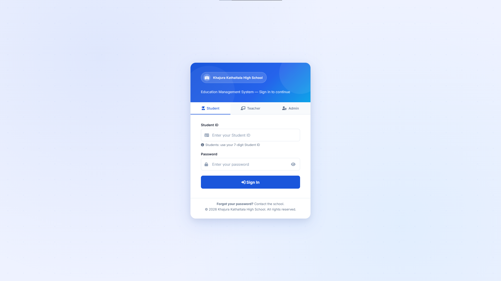

## Administrator dashboard

School overview, charts, and quick navigation.

Page: `admin/dashboard.php` · Image: `docs/screenshots/admin-dashboard.png`

## Student admission

Admission form, enrollment details, and subject choices. Use fictional names and contact details, and keep any generated password out of the capture.

Page: `admin/admission.php` · Image: `admin-admission.png`

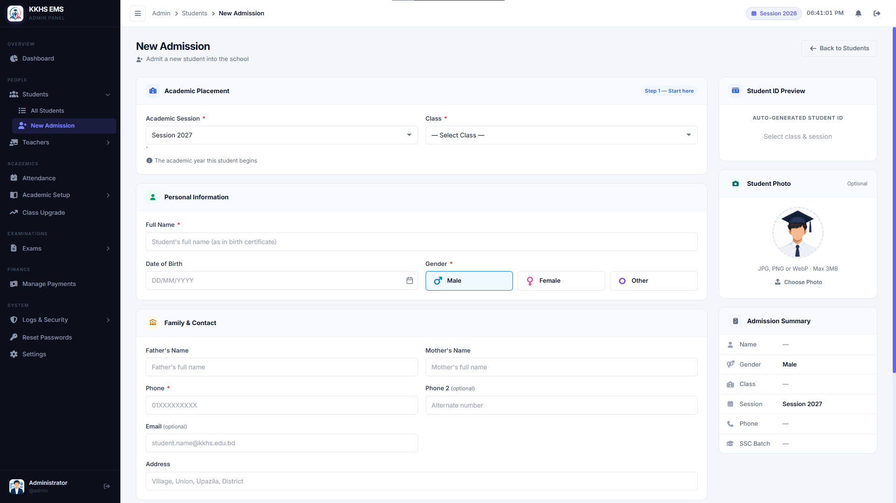

## Student management

Student records, filters, and profile tools.

Page: `admin/students.php` · Image: `admin-students.png`

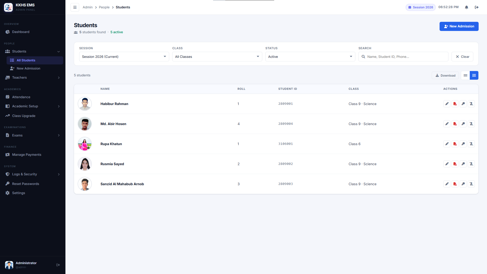

## Teacher management

Teacher records and account tools.

Page: `admin/teachers.php` · Image: `admin-teachers.png`

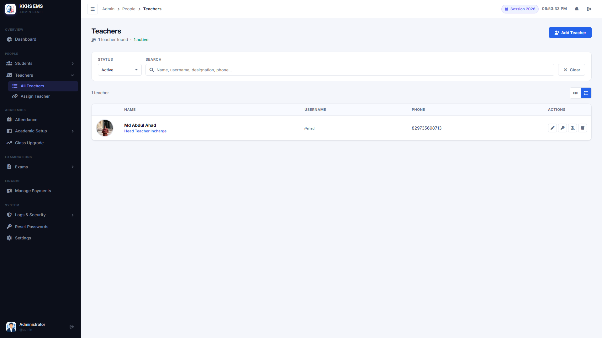

## Class routine

Timetable slots and teaching assignments.

Page: `admin/routine.php` · Image: `admin-routine.png`

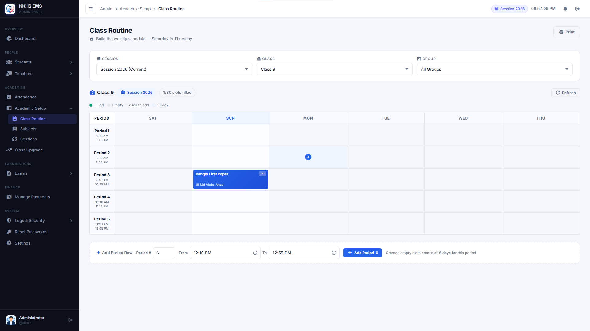

## Attendance

Attendance entry and reporting.

Page: `admin/attendance.php` · Image: `admin-attendance.png`

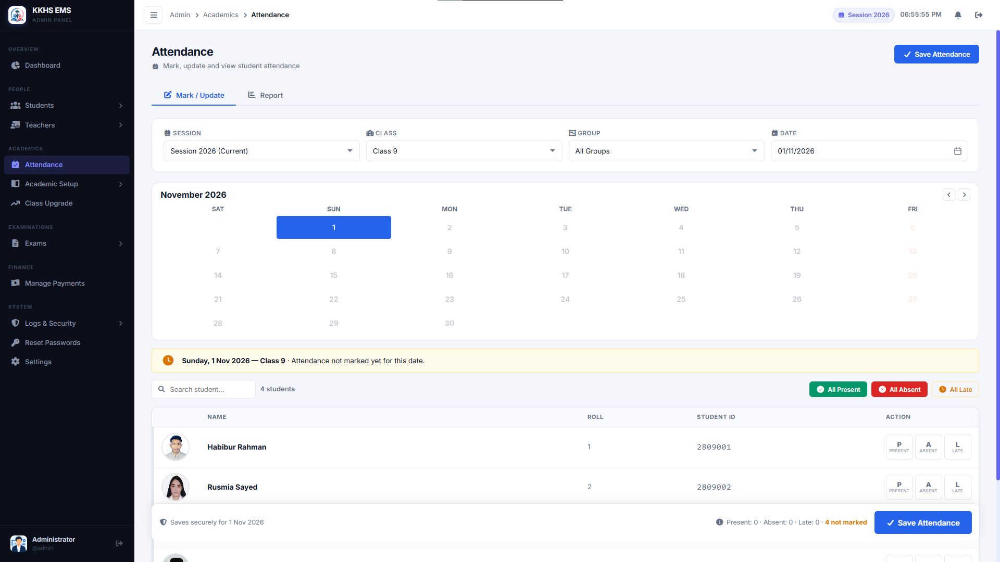

## Examinations

Exam configuration and subject schedules.

Page: `admin/exams.php` · Image: `admin-exams.png`

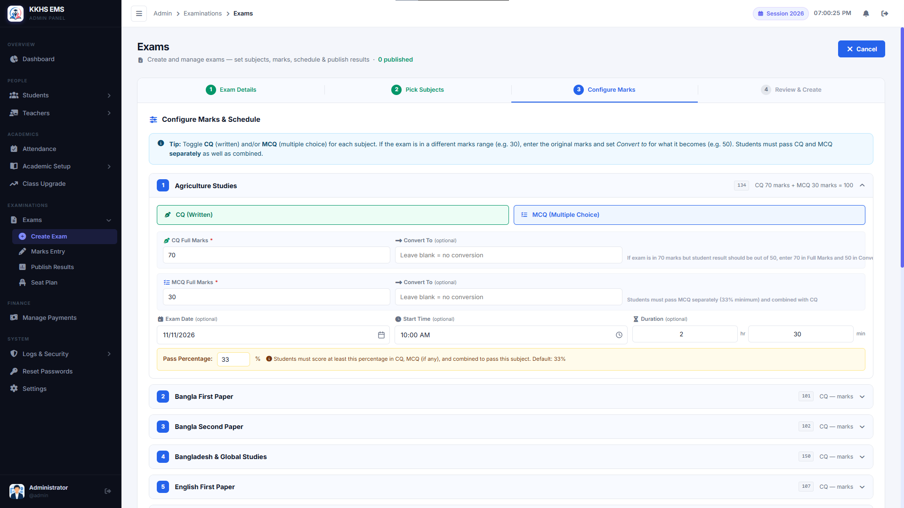

## Marks and results

Result previews and publication tools.

Page: `admin/results.php` · Image: `admin-results.png`

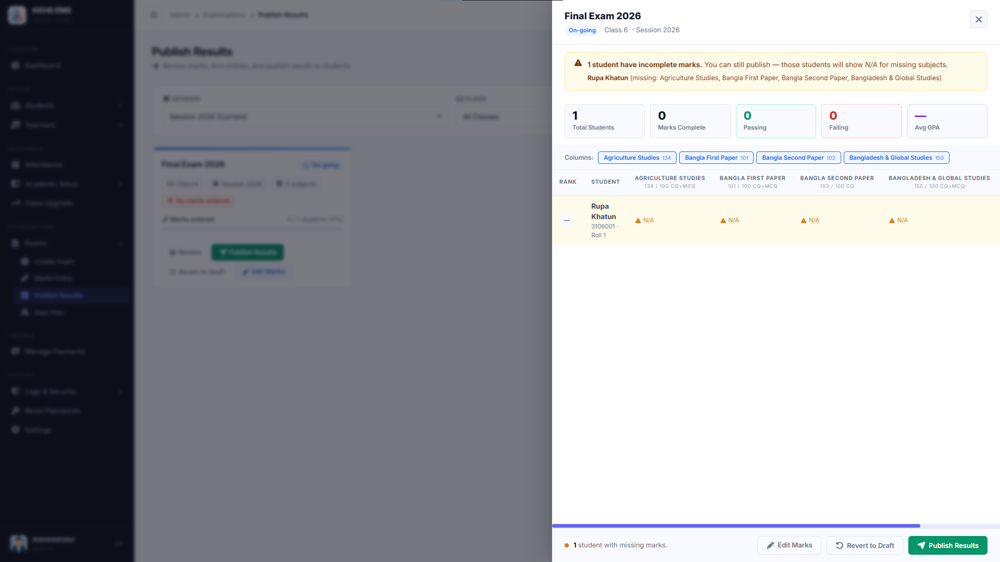

## Exam seat planning

Shared rooms, student participation, and seat allocation.

Page: `admin/seat-plan.php` · Image: `admin-seat-plan.png`

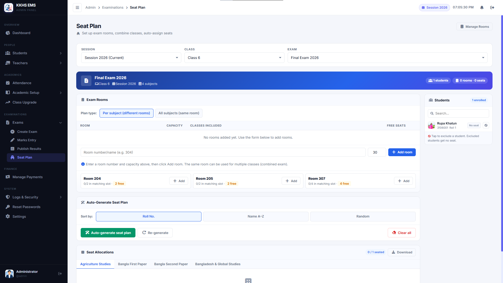

## Payments

Student dues, payment records, and ledgers.

Page: `admin/payments.php` · Image: `admin-payments.png`

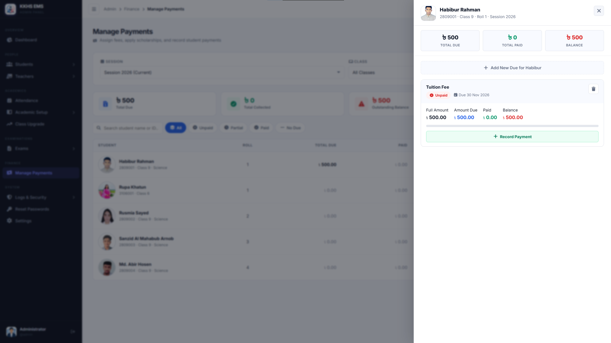

## School settings

School profile, logo, and maintenance controls.

Page: `admin/settings.php` · Image: `admin-settings.png`

## Teacher dashboard

Teaching overview and pending work.

Page: `teacher/dashboard.php` · Image: `teacher-dashboard.png`

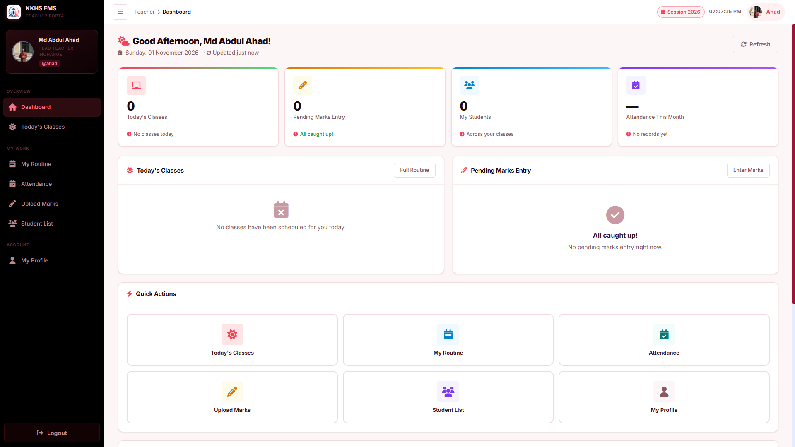

## Teacher marks entry

Marks entry for assigned subjects.

Page: `teacher/marks.php` · Image: `teacher-marks.png`

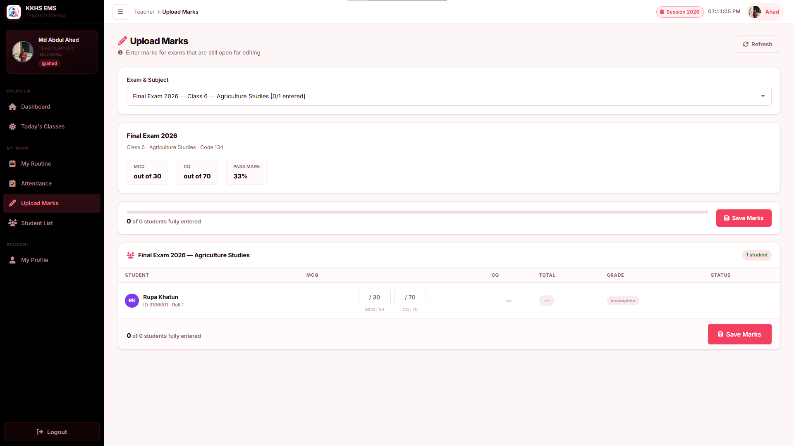

## Student dashboard

Personal academic overview and portal navigation.

Page: `student/dashboard.php` · Image: `student-dashboard.png`

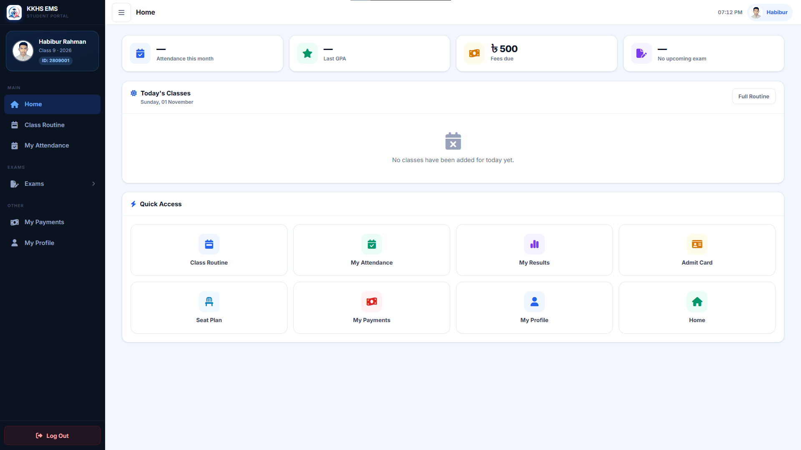

## Student results

Published examination results.

Page: `student/results.php` · Image: `student-results.png`

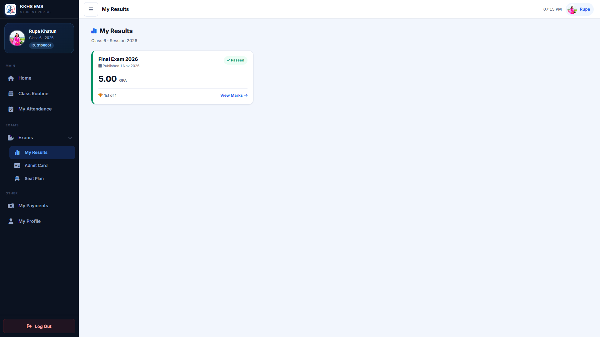

## Student admit card

Printable examination admit card.

Page: `student/admit-card.php` · Image: `student-admit-card.png`

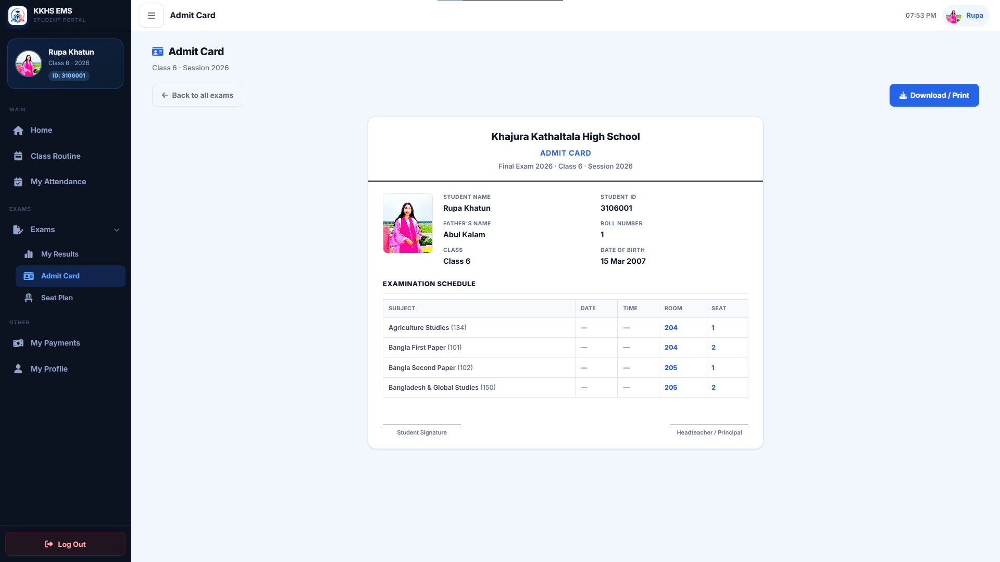

## Student seat plan

Personal examination room and seat details.

Page: `student/seat-plan.php` · Image: `student-seat-plan.png`

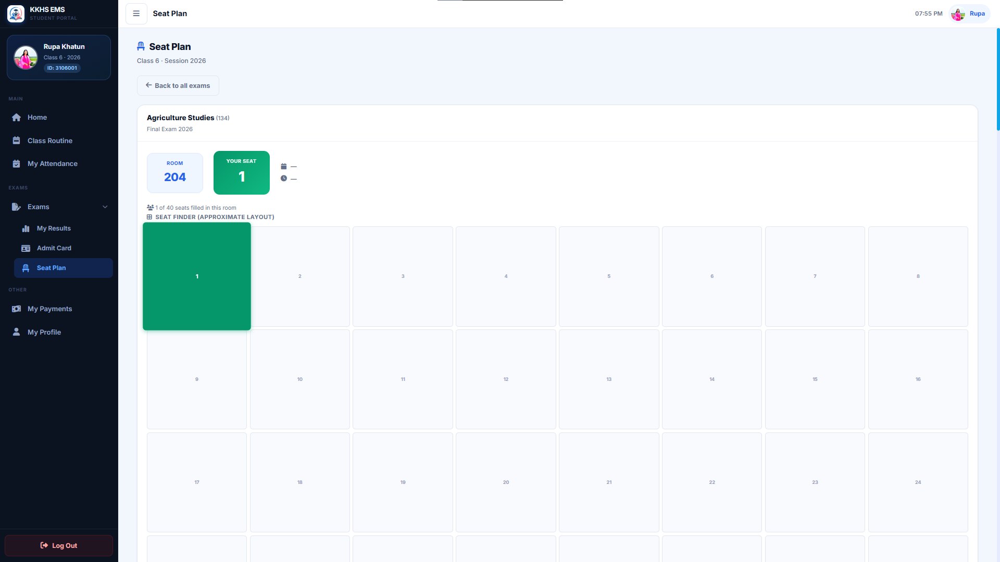

## Student payment ledger

Personal dues and payment history.

Page: `student/payments.php` · Image: `student-payments.png`

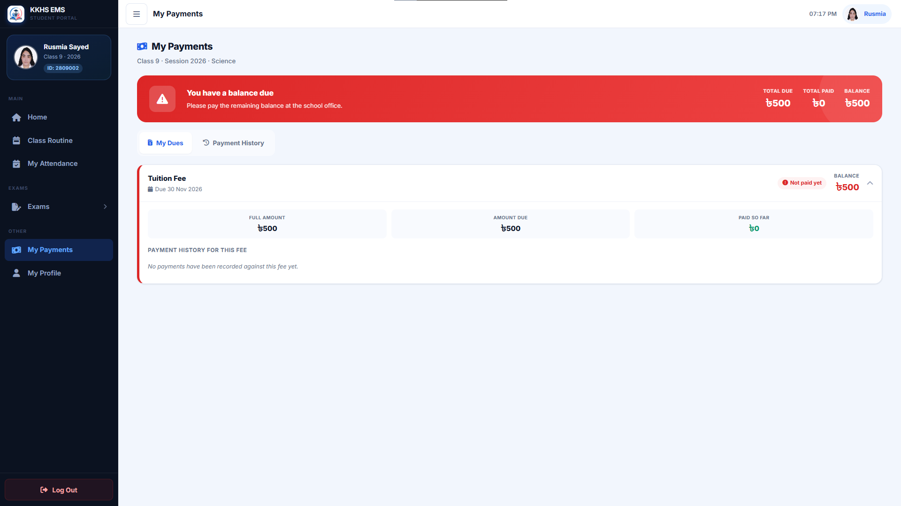
